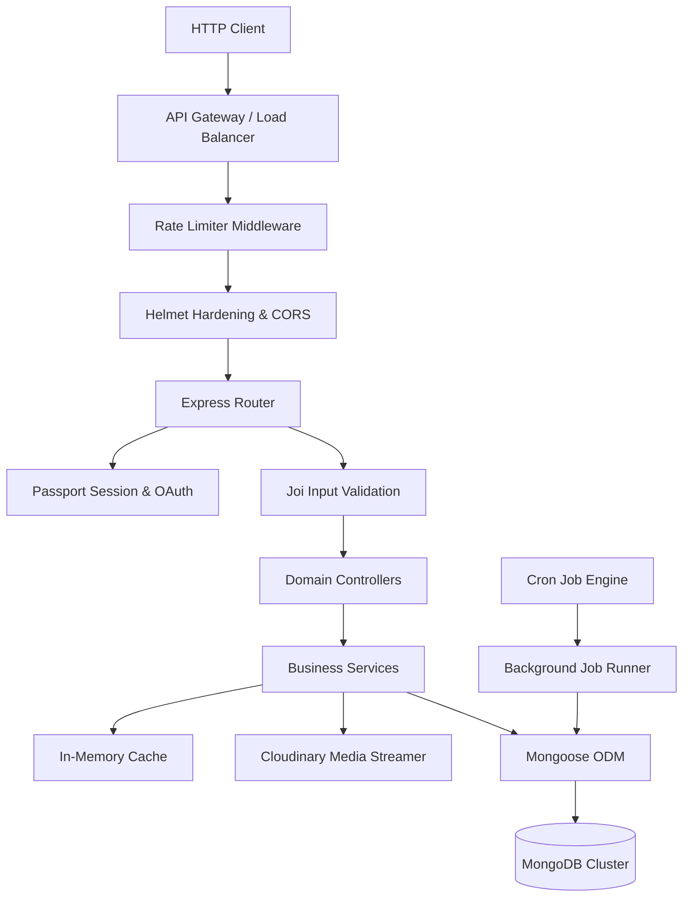

# Portal Api

A highly optimized, multi-tenant capable talent acquisition and human resource management gateway engineered for enterprise-grade recruitment lifecycles.

Portal Api serves as the core backend engine for the Nezuko recruitment ecosystem. The project is architected to address the operational complexities of talent acquisition pipelines, offering a robust, secure, and localized portal for candidates, clients, and system administrators.

## Overview

Portal Api is built on a clean Node.js and TypeScript foundation, leveraging Express for its request-response pipeline. The architecture is engineered around the principles of separation of concerns, defensive security boundaries, and high throughput.

### Problem Space
Enterprise recruitment systems are frequently bogged down by legacy interfaces, slow search capabilities, fragile file upload configurations that degrade server disk I/O, and rigid single-language database designs. This results in poor system reliability and significant friction in global hiring operations.

### Proposed Solution
Portal Api establishes a stateless, event-driven architecture that decouples key domains—such as authentication, job indexing, resume processing, and dynamic localized search—into dedicated service models.

### Engineering Philosophy
* Strict Type Safety: Developed entirely in TypeScript with strict compiler options to eliminate runtime type anomalies.
* Security by Default: Security controls are enforced at the transport, routing, and database query levels.
* Layered Responsibility: Business logic is decoupled from HTTP handlers, ensuring that routing layers are simple and unit testing is isolated.

---

## Why This Project Exists

The system is designed to provide recruitment teams with a reliable, self-documenting gateway capable of processing resume parsing, role-based workflows, and cross-border candidate databases. It exists to solve core developer concerns, including:

* Database Schema Resilience: Ensuring document structures remain clean and standardized through dynamic schema migrations and seed configurations.
* Performant Asset Streaming: Eliminating local disk storage limits on horizontal container instances (like AWS ECS or Kubernetes Pods) by utilizing direct-to-CDN buffer streaming.
* Bi-directional Localization: Maintaining full-fidelity search capability in both English and Arabic.

---

## Architecture

The system utilizes an layered MVC routing pipeline with middleware validation boundaries.



---

## Core Features

### Authentication & Authorization
* Dual Auth Engine: Fully supports local credential authorization alongside Passport-based OAuth 2.0 flows for Google and GitHub.
* Stateful Sessions: Employs signed cookies and session stores with rolling expiration cycles (`rolling: true`) and custom cookie lifetimes to mitigate session hijacking.
* RBAC (Role-Based Access Control): Custom middleware (`check_roles.middleware.ts`) protects administrative endpoints, separating permissions for Administrators, Clients, Candidates, and Guests.

### Modular Architecture
* Layered Component Design: Controllers handle parsing and response construction, Services encapsulate business workflows, and Models manage structural interactions.
* Resource Isolation: Separate domain routing for Authentication, Users, Jobs, Applications, FAQs, and geographical configurations.

### Validation Layer
* Request Hardening: Dynamic schema filtering using Joi validation models before execution reaches controllers.
* Safe ID Parsing: ObjectId parameters are verified against standard hex patterns (`validateObjectId.ts`) prior to database lookup, preventing query injections.

### Robust Error Handling
* Centralized Error Boundaries: Implements a custom class structure extending native error objects with state tracking (`AppError`, `BadRequestError`, `NotFoundError`).
* Global Middleware Handler: Intercepts all failed operations, sanitizing stack traces in production environment states and returning unified JSON response packages.

### Security Implementation
* Network Hardening: Integrated Helmet HTTP header guards to block MIME sniffing, clickjacking, and cross-site scripting (XSS).
* Strict CORS Profiling: Configuration whitelists access strictly to designated client origins.
* Secure Session Naming: Obfuscates underlying technologies by overriding default Express session identifiers.

### Performance Optimization
* In-Memory Cache: Utilizes `node-cache` to store heavy static data categories (e.g. country indexes, FAQ collections, experience levels), dropping database round-trip times.
* Parallel Query Fetching: Orchestrates database calls via `Promise.all` patterns to reduce operational latency during paginated searches.

### Caching Architecture
* Decoupled Lookups: Caches key-value mappings locally to improve response times on static global resource endpoints.
* Automatic Eviction: Employs configurable time-to-live (TTL) counters to refresh cache states dynamically.

### Rate Limiting
* Brute-Force Shielding: Global and route-specific rate limits powered by `express-rate-limit` block malicious traffic patterns and credential-stuffing campaigns.

### Background Jobs
* Cron Daemon: Background routines powered by `node-cron` run asynchronously (`expire-jobs.ts`).
* Automatic Job Expiration: Periodically analyzes application limits and expires listings that have passed active validation windows, preventing resource bloat.

### File Upload Pipelines
* Diskless uploads: Multi-part form data processed through Multer memory storage.
* Streamed CDN Ingestion: Direct piping via `streamifier` buffer streams into Cloudinary CDN, bypassing server disk write limits and keeping containers stateless.

### API Versioning
* Semantic Routing: Standardized URL path versioning (`/api/v1` or `/api/`) shields front-end integrations from major database structure updates.

### API Documentation
* Automated OpenAPI Spec: Fully documented REST definitions powered by `swagger-jsdoc` and `swagger-ui-express`.
* Interactive Sandbox: Accessible at `/api-docs` to allow sandbox testing of all active routes.

---

## API Endpoints

All route requests are prefixed by `/api`.

### Authentication
| Method | Route | Access | Description |
|:---|:---|:---|:---|
| `POST` | `/auth/signup` | Public | Register a new user candidate account |
| `POST` | `/auth/login` | Public | Authenticate credentials and establish session (rate-limited) |
| `GET` | `/auth/logout` | Public | Invalidate current session and clear tokens |
| `POST` | `/auth/refresh-token` | Public | Re-issue expired access tokens via refresh token rotation |
| `POST` | `/auth/forgot-password` | Public | Trigger password reset OTP generation |
| `POST` | `/auth/verify-reset-code` | Public | Validate email OTP verification codes |
| `POST` | `/auth/reset-password` | Public | Complete credential update using validated codes |
| `GET` | `/auth/google` | Public | Initiate Google OAuth 2.0 redirection flow |
| `GET` | `/auth/google/callback` | Public | Process Google redirection payload and cookies |
| `GET` | `/auth/github` | Public | Initiate GitHub OAuth 2.0 redirection flow |
| `GET` | `/auth/github/callback` | Public | Process GitHub redirection payload and cookies |
| `POST` | `/auth/github/revoke` | Public | Terminate GitHub authorization grant |

### User Profile
| Method | Route | Access | Description |
|:---|:---|:---|:---|
| `GET` | `/user/me` | Authenticated | Retrieve current user profile values |
| `PATCH` | `/user/avatar` | Authenticated | Upload and set user profile image (multipart/form-data) |
| `PATCH` | `/user/cv` | Authenticated | Upload and set candidate resume PDF (multipart/form-data) |

### Job Listings
| Method | Route | Access | Description |
|:---|:---|:---|:---|
| `GET` | `/job` | Public | List, search, and paginate active job listings |
| `GET` | `/job/:id` | Public | Fetch comprehensive details of a single job post |
| `POST` | `/job` | Admin | Publish a new job opening (schema-validated) |
| `PATCH` | `/job/:id` | Admin | Modify attributes of a job listing |
| `DELETE` | `/job/:id` | Admin | Soft-delete a job listing |
| `PATCH` | `/job/toggle-activation/:id` | Admin | Toggle job vacancy between active and inactive state |

### Job Applications
| Method | Route | Access | Description |
|:---|:---|:---|:---|
| `POST` | `/job-application/apply/:jobId` | Candidate | Submit application for a job (requires CV document) |
| `GET` | `/job-application/my-applications` | Candidate | Retrieve current user's job applications |
| `GET` | `/job-application/my-applications/:id` | Candidate | Retrieve details of a specific personal application |
| `DELETE` | `/job-application/my-applications/:id` | Candidate | Cancel a pending application |
| `GET` | `/job-application/admin/all` | Admin | Retrieve all job applications across all jobs |
| `GET` | `/job-application/admin/job/:jobId` | Admin | Retrieve applications received for a specific job |
| `PATCH` | `/job-application/admin/:id/status` | Admin | Modify application status (pending to accepted/rejected) |

### Categories
| Method | Route | Access | Description |
|:---|:---|:---|:---|
| `GET` | `/category` | Public | List all configured job categories |
| `GET` | `/category/:id` | Public | Fetch a specific category by ID |
| `POST` | `/category` | Admin | Establish a new job category |
| `PATCH` | `/category/:id` | Admin | Modify details of an existing category |
| `DELETE` | `/category/:id` | Admin | Remove a job category |

### Experience Levels
| Method | Route | Access | Description |
|:---|:---|:---|:---|
| `GET` | `/experience` | Public | List all experience level configurations |
| `GET` | `/experience/:id` | Public | Get details of a single experience level |
| `POST` | `/experience` | Admin | Add a new experience level descriptor |
| `PUT` | `/experience/:id` | Admin | Update an experience level descriptor |
| `DELETE` | `/experience/:id` | Admin | Remove an experience level descriptor |

### Keywords
| Method | Route | Access | Description |
|:---|:---|:---|:---|
| `GET` | `/keyword` | Public | Retrieve all search keywords/tags |
| `GET` | `/keyword/:id` | Public | Retrieve details of a single keyword |
| `POST` | `/keyword` | Admin | Create a new search keyword/tag |
| `PUT` | `/keyword/:id` | Admin | Update a keyword descriptor |
| `DELETE` | `/keyword/:id` | Admin | Remove a keyword from listings |

### Countries & Locations
| Method | Route | Access | Description |
|:---|:---|:---|:---|
| `GET` | `/country` | Public | Fetch listing of supported countries |
| `GET` | `/country/:id` | Public | Fetch location details of a single country |
| `POST` | `/country` | Admin | Configure a new country profile |
| `PATCH` | `/country/:id` | Admin | Edit parameters of an existing country profile |
| `DELETE` | `/country/:id` | Admin | Delete a country profile |

### FAQs
| Method | Route | Access | Description |
|:---|:---|:---|:---|
| `GET` | `/faq` | Public | List all FAQ items |
| `GET` | `/faq/:id` | Public | Get detailed FAQ item |
| `POST` | `/faq` | Admin | Publish a new FAQ |
| `PUT` | `/faq/:id` | Admin | Replace an existing FAQ |
| `DELETE` | `/faq/:id` | Admin | Remove an FAQ |

### Contact Forms
| Method | Route | Access | Description |
|:---|:---|:---|:---|
| `POST` | `/contactus` | Public | Submit inquiries or contact messages |
| `GET` | `/contactus` | Admin | Retrieve all contact form submissions |
| `GET` | `/contactus/:id` | Admin | Fetch details of a specific submission |

---

## Directory Structure

```
nezuko-portal-api/
├─ src/
│  ├─ config/         # Database, Passport, CORS, cache, and i18n configurations
│  ├─ controllers/    # Route controllers handling request parsing and execution
│  ├─ docs/           # OpenAPI / Swagger JSON specification files
│  ├─ jobs/           # Scheduled cron tasks (e.g., job expiration runner)
│  ├─ locales/        # JSON translation catalogs (English / Arabic)
│  ├─ middlewares/    # Authentication, RBAC, file upload, Joi validation, rate limiters
│  ├─ models/         # Mongoose schema definitions (User, Job, JobApplication)
│  ├─ routers/        # Resource-based routing tables (User, Auth, Job routes)
│  ├─ seeders/        # Pre-populated seed engines for database initialization
│  ├─ services/       # Decoupled business logic and third-party integrations
│  ├─ tests/          # Jest & Supertest integration suite
│  ├─ utils/          # Universal helper functions and error boundary classes
│  ├─ app.ts          # Express application initialization and middleware wiring
│  └─ server.ts       # Server entrypoint and database connection handler
├─ package.json       # Project dependencies and script runner configurations
├─ tsconfig.json      # TypeScript compiler directives
└─ README.md          # Project documentation
```

---

## Getting Started

### Prerequisites
* Node.js (v18 or higher)
* MongoDB (v6.0 or higher)
* Cloudinary Account (for resume/avatar storage)

### Installation

1. Clone the repository and navigate to the directory:
   ```bash
   git clone https://github.com/Nezuko-G/Portal-Api.git
   cd Portal-Api
   ```

2. Install the package dependencies:
   ```bash
   npm install
   ```

3. Create a `.env` configuration file in the project root:
   ```env
   PORT=3000
   NODE_ENV=development
   MONGODB_URL=mongodb://localhost:27017/nezuko
   SESSION_SECRET=your_secure_session_secret
   
   CLOUDINARY_CLOUD_NAME=your_cloudinary_cloud_name
   CLOUDINARY_API_KEY=your_cloudinary_api_key
   CLOUDINARY_API_SECRET=your_cloudinary_api_secret
   
   EMAIL_HOST=smtp.mailtrap.io
   EMAIL_PORT=2525
   EMAIL_USER=your_smtp_username
   EMAIL_PASS=your_smtp_password
   
   GOOGLE_CLIENT_ID=your_google_oauth_client_id
   GOOGLE_CLIENT_SECRET=your_google_oauth_client_secret
   GITHUB_CLIENT_ID=your_github_oauth_client_id
   GITHUB_CLIENT_SECRET=your_github_oauth_client_secret
   ```

4. Populate lookup collections and test records using the seeding utility:
   ```bash
   npm run seed:all
   ```

5. Launch the local development server:
   ```bash
   npm run dev
   ```

---

## Verification & Testing

The code includes tests built using Jest and Supertest.

### Execution

Run the complete test suite:
```bash
npm run test
```

Watch mode for active development:
```bash
npm run test:watch
```
